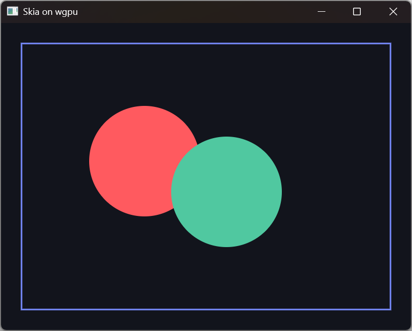

# skia-wgpu-winit-min

用 winit `0.31.0-beta.4` + `skia-safe` `0.158.0` 的 Graphite／wgpu 后端写的最小示例：
窗口由 winit 创建，wgpu 负责交换链，Skia 直接画进交换链纹理。

## 为什么需要源码构建

`skia-safe` 的 `wgpu` 特性需要 `skia-bindings` 编译 Skia 的 Dawn 后端（`skia_use_dawn`）并生成
`webgpu.h`，这个变体没有发布预编译二进制（release 里只有 `-graphite-...` 系列，没有 `-wgpu`），
所以第一次构建会自动下载 Skia 源码并用 GN + Ninja 编译，Windows 上还要求安装 LLVM（clang-cl）。

## 本地构建

```bash
# 需要：Rust stable、Python 3、Ninja、LLVM（clang-cl）、MSVC
set LLVM_HOME=C:\Program Files\LLVM
set SKIA_SOURCE_DIR=D:\caches\skia-src
cargo build --release
cargo run --release      # 开窗，Skia 绘制
cargo run --release --bin offscreen-check   # 离屏渲染 + 像素断言，无需显示器
```

## 文档

[docs/skia-wgpu-winit-notes.md](docs/skia-wgpu-winit-notes.md) 记录了三者结合时的注意事项：
依赖怎么选、为什么必须源码构建、Windows 上几个构建坑（registry 不可写、符号链接需要特权、
`SKIA_SOURCE_DIR` 会进 offline 而 offline 不支持 wgpu）、winit 0.31 beta 的 API 迁移、
wgpu 30 的变化、Graphite 的调用顺序与析构顺序、颜色空间、以及无显示器时的像素断言验证法。

## 运行结果



CI（windows-2022，源码构建 Skia）跑通后，本地运行这个 exe 的效果：窗口由 winit 创建，wgpu 拿到交换链纹理，
Skia 用 Graphite 直接画进去——两个圆和一个描边矩形都是 Skia 的 `draw_circle` / `draw_rect` 画的。

## 与官方示例的差异

官方 `skia-safe/examples/wgpu-window` 用的是 winit 0.30。winit 0.31 的 API 变了：

- 窗口变成 `Box<dyn Window>`，事件循环回调从 `resumed` 换成 `can_create_surfaces`，
- `EventLoop::run_app` 按值接收 app（要求 `'static`），
- `WindowEvent::Resized` 改名为 `SurfaceResized`，
- `ActiveEventLoop` 变成 trait，回调里用 `&dyn ActiveEventLoop`。

因此这里额外包了一层 `OwnedWindow(Arc<dyn Window>)` 来实现 `HasWindowHandle`／`HasDisplayHandle`，
这样 `wgpu::Surface` 才能拿到 `'static` 生命周期。
